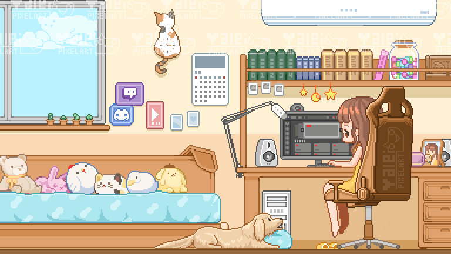

#  Hi! Welcome to my GitHub, I'm Michelle 

## a little about me 

<table>
<tr>
<td valign="top" width="60%">

I'm a Computer Engineering student at the University of Waterloo who splits time between embedded systems, full-stack apps, and machine learning depending on my mood. I'm a big fan of building things I can touch like FPGAs, PCBs and any sort of wearable hardware. But of course, software & design still has a special place in my heart.

**what I'm building right now:** 
-  **INT4 GEMV Accelerator** — RTL for LLM decode-time INT4 matrix-vector math
-  RTL for a 10 Gbps Ethernet packet parser & Ray Tracer at **UWASIC**
-  **MeshGit** — geometry-aware version control for 3D mesh files
-  **hand.shake** — an AI grip-assist wearable glove

**outside of code:** 

- I love taking photos, especially .5s!
- I trained in Bharatanatyam (classical Indian dance) for 10 years
- love to lift @ gym
- always painting, pottery and any sort of art where I can touch!
- purple!

</td>
<td valign="top" width="40%" align="center">

</td>
</tr>
</table>

## my tech stack

**Frameworks & Libraries:** 🌷

**Embedded & Hardware:** 🦋

**Tools & Platforms:** 🎧

##  GitHub contributions 

<table>
<tr>

<td valign="middle">

</td>
</tr>
</table>

<picture>
  <source media="(prefers-color-scheme: dark)" srcset="https://raw.githubusercontent.com/m76domi98/m76domi98/output/snake-dark.svg">
  <source media="(prefers-color-scheme: light)" srcset="https://raw.githubusercontent.com/m76domi98/m76domi98/output/snake.svg">
  
</picture>

thanks for stopping by 💌

